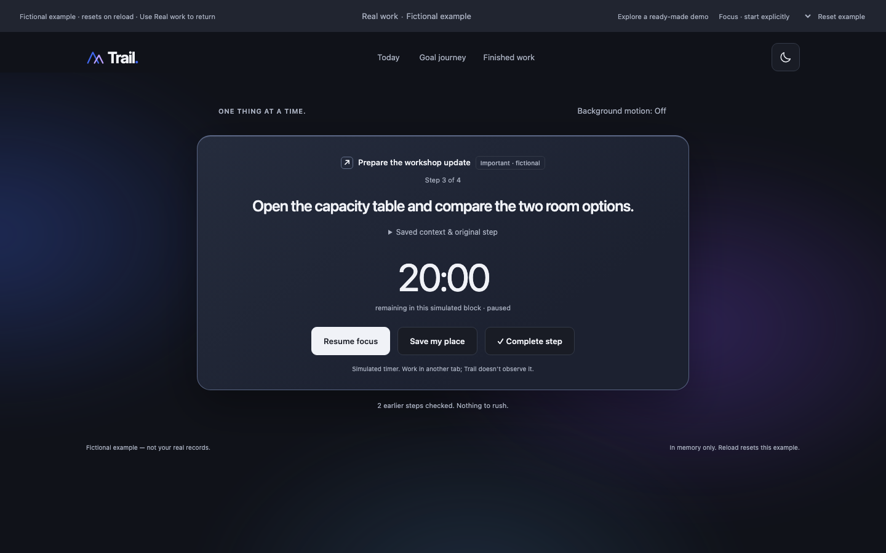
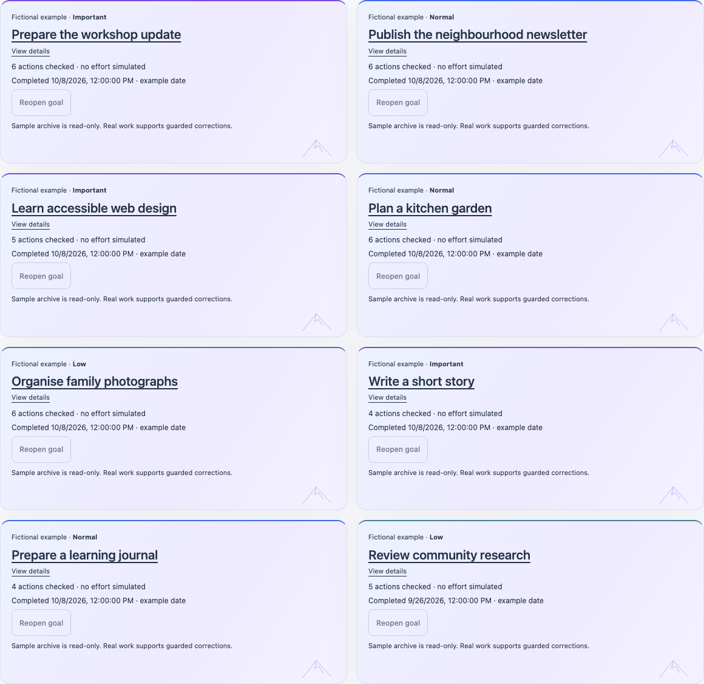

<div align="center">

# Trail

### Keep your place. Find your next step.

A focus companion for work that gets interrupted.

**Plan a goal · Focus on one action · Leave a way back**

[Explore Trail](#explore-trail) · [Quick start](#quick-start) · [Try the full loop](#try-the-full-loop) · [AI setup](#optional-gemini-planning) · [Engineering](#under-the-surface)

</div>



*An actual screenshot of the labelled fictional example. Its work and timing are illustrative, separate from your records.*

## The problem Trail tackles

You return to a task called **“Prepare the presentation.”** But where were you? Which file was open? What decision did you need to make next?

A task title tells you what remains. Trail lets you leave the detail that helps you restart:

> “Open slide 3. Add the room-booking owner, then check whether the capacity is confirmed.”

For students, solo builders and people working on interrupted projects, Trail brings that next move, optional context and a work link back into view before the progress graphic. These are intended audiences, not claims of completed user studies.

**The mountain tells the story of deliberate completion. Your saved place tells you how to continue.**

## Explore Trail

| Space | What you can do |
| --- | --- |
| **Today** | Return to your unfinished action, read its saved next move and open your work reference. |
| **Focus** | Explicitly Start or Resume, pause, extend a block or complete the action. Switch themes and turn slow background motion off when you prefer. |
| **Goal journey** | Revisit ordered actions and the mountain route. Completed actions advance the illustration; selecting a step does not complete it. |
| **Finished work** | Read completed goals and their saved details, explore twelve months of activity, and see correction-aware streaks. |
| **Later goals** | Keep up to ten separate outcomes without replacing active work. Review/edit now; explicitly make one active after the current goal is finished. |
| **Plan with AI** | Optionally turn a rough description into an editable goal, finish condition and ordered actions with suggested estimates. Manual creation always remains available. |

### A quick path for judges

After starting the app, choose **Try a ready-made demo** on Home. No API key or account is needed.

1. **Return to saved work:** see the next move and context that make an interrupted task easier to pick up.
2. **Focus:** explicitly start the simulated block, pause and save a place. Switch themes or turn background motion off.
3. **Explore sample activity / Finished collection:** inspect the year view and open a finished goal's full details.
4. **Capture a step or a later goal:** read the labelled illustration of keeping the current action while remembering more work.

Choose **Real work** at the top to try the persistent workflow below. Fictional examples stay in memory, reset on reload and never seed real records or call Gemini. The capture example is read-only; use Real work to save steps and Later goals.

<details>
<summary><strong>Preview Finished work in light mode</strong></summary>



These are fictional sample records. Their disabled reopening controls are intentional: Real work supports guarded reopening when no other goal is active.

</details>

## Quick start

**You need Git and Node.js 20 or newer, including npm.** Node.js 24.16.0 was used for the latest verification. Use a current browser with IndexedDB and Web Locks; Chromium was used for automated browser checks.

```sh
git clone --branch codex/trail-redesign https://github.com/MitPanchal14/Trail.git
cd Trail
npm run dev
```

Open **[http://127.0.0.1:3000/](http://127.0.0.1:3000/)**.

**No `npm install`, API key or sign-in is needed for manual work and fictional examples.** The application has no third-party runtime package dependencies.

The clone command targets the reviewed development branch. Once merged into `main`, a normal clone of the default branch will contain the same application.

<details>
<summary><strong>Port already in use?</strong></summary>

Choose a free port and open the address printed by the server:

```sh
npm run dev -- --port 52257
```

Records belong to a particular browser **and site address**. Different ports have separate records. An empty app on a new port does not mean the previous port's work was deleted.

</details>

## Try the full loop

Use **Real work** for this walkthrough. It works without AI.

1. **Create a goal.** Choose Start working. Enter a title, what finished means and ordered actions. Save the goal.
2. **Start deliberately.** Start focus on the first unfinished action. Saving a goal never starts its timer.
3. **Leave a useful place.** Pause. Write the exact first thing to do when returning; optionally add context and a work link. Save and return to Today.
4. **Come back.** Reload the same address. Your committed next move is still there. Open your work reference and explicitly Resume when ready.
5. **Capture without replacing.** Add a step to the current goal, or save a separate goal for later. Running capture explicitly pauses first; it keeps the current action and block. Resume is your choice.
6. **Finish deliberately.** Complete actions. Checking every action opens review; explicitly confirm the goal finished to reach the summit and save it in Finished work.

**One active goal. One focus block. More work safely remembered for later.** Later-goal capture is currently manual; AI planning is available when creating a new active goal.

<details>
<summary><strong>What do the mountain, campsite and streaks mean?</strong></summary>

- A committed action completion advances the illustrative journey. Selecting or viewing an action earns nothing.
- A useful saved next move, context or link with timing stopped creates a campsite cue. It is a way back, not another completed task.
- All actions checked is a review state. Only explicitly confirming the goal finished earns the summit.
- Activity and streaks come from currently checked actions and their dates. Undo and reopening can reduce them.
- Suggested estimates, recorded effort and completed outcomes are different quantities. The mountain does not measure distance, attention or productivity.

</details>

## Optional Gemini planning

Prefer to start with a rough paragraph? **Plan with AI** suggests a goal, an observable finish condition and ordered actions with editable estimates, assumptions and conflicts.

**Describe → Draft my trail → Review/edit → Save this goal → Start separately**

Type, paste or use your device's dictation in the text field. Trail does not activate dictation or record/transcribe audio through its UI. Deadline text and available minutes guide a suggestion; they are not calendar scheduling or a feasibility guarantee.

<details>
<summary><strong>Enable Gemini locally — server-side configuration</strong></summary>

Manual work needs no configuration. To enable planning, use a Gemini API key and a model available to your API project. A coding-agent subscription is separate from app API access.

Create a **private `.env.local` in the repository root**, or edit your existing file without replacing its other settings:

```dotenv
GEMINI_API_KEY=replace_with_your_key
GEMINI_MODEL=replace_with_your_enabled_model
```

The values above are placeholders. Keep your actual key private; never paste it into browser code, a screenshot, a public issue or a commit. `.env*` is Git-ignored.

Restart the Node server after configuration changes. Its CLI loads `.env.local` when `process.loadEnvFile` is available (Node 20.12+); older Node 20 installations need the values supplied through the server environment instead.

Only the description and optional deadline/budget you explicitly submit are sent to Gemini through the server. Saved workspace, history, notes and work links are not included. Google processes submitted text under its API terms; Trail does not promise provider zero retention.

The animated mountain appears only while a request is pending, and stays static with reduced motion. Cancel keeps your description; safe errors preserve the manual route. There are no automatic retries. Review the proposal before saving: AI can be wrong.

The server key is never injected into the static build. Serving `dist/` alone supports manual work but **does not provide Gemini endpoints**. The included server binds to loopback; it is a local server, not a turnkey public AI deployment. Public hosting needs a suitable server deployment and additional abuse/cost controls.

</details>

## Your records and recovery

Trail stores committed real work in **IndexedDB in your browser**. It has no account, cloud sync or external activity tracking. Keep using the same browser/site address; clearing site data can lose records. Unsaved forms and AI proposals are memory-only and lost on reload.

<details>
<summary><strong>Failed saves, multiple tabs and timing</strong></summary>

| Situation | Trail's behaviour |
| --- | --- |
| A write fails | Keep the page open and choose Retry. The draft and exact pending operation are retained; success appears only after commit. |
| Another tab owns the workspace | The second tab is read-only. Close the writer, then explicitly Retry ownership. |
| You reload or return after uncertain timing | Resume is explicit. Gaps over 15 seconds and clock disagreement interrupt timing; uncertain gaps are not credited. The last uncommitted tail can be lost. |
| You leave a blank pause field or Skip | Existing saved context is preserved. Removing saved text/link requires the explicit removal control and Save. |
| You want to reorder actions during a block | Pause and explicitly End focus block first. This keeps the action unfinished, saved place and recorded effort. Append-only capture does not require ending the block. |
| You check an action accidentally | Limited Undo restores its previous context/stopped state until the next saved domain change. Guarded history corrections retain recorded effort. |
| Local data cannot be validated | Records are preserved; raw export is offered where readable. There is no destructive automatic reset. |

Copy saved place has a manual-copy fallback. It is a handoff convenience, not backup or sync. Opening a work link neither starts timing nor tells Trail what happens in the other tab.

There is currently no import/restore, reminders, background capture or real-record deletion/pruning workflow. The UI does not claim to observe attention. Physical sleep, Safari, native phone keyboards and device dictation remain separate from automated Chromium evidence.

</details>

## Under the surface

**HTML + CSS + browser JavaScript modules + custom SVG**, with a Node HTTP server and an optional server-only Gemini proxy. Nine public application assets; no application framework or runtime package dependencies.

| Part | Responsibility |
| --- | --- |
| `demo/index.html`, `styles.css` | Responsive interface, light/dark themes and reduced-motion presentation. |
| `work.js`, `planner.js` | Real-work UI, pause/capture flow and reviewed optional planning. |
| `state.js` | Validated transitions, stable identities, one active goal and bounded Later queue. |
| `storage.js`, `timing.js`, `activity.js` | Transactional local persistence, writer ownership, conservative timing and derived activity. |
| `proof.js` | Labelled in-memory fictional examples, isolated from real records. |
| `scripts/serve.mjs`, `scripts/ai.mjs` | Allowlisted local serving and bounded server-only API requests. |

The reliability goal is straightforward: **a success message must correspond to committed work, and retrying a failed save must not duplicate it.** Explicit completion, planning estimates and measured effort remain separate.

### Verification

```sh
npm run check
npm test
npm run build
```

- **55 Node tests passed** in the latest independent review.
- **The full Chromium browser regression passed**, including real IndexedDB abort/Retry, ownership, reload/recovery, capture/queue, planning mocks and fictional isolation.
- Additional touch-enabled checks covered 320px, 390px and landscape in both themes. Viewport/touch emulation is not physical-device acceptance.
- The build contains exactly nine public assets; protected engines/API remained unchanged in the final capture/polish pass, and private/server/test paths returned 404.

See the [independent review](devpost/INDEPENDENT_FINAL_PRODUCT_POLISH_REVIEW.md) and [implementation evidence](devpost/FINAL_PRODUCT_POLISH_EVIDENCE.md) for scope and limitations. These are technical results, not proof of improved productivity or a completed user study.

<details>
<summary><strong>Optional browser regression tooling</strong></summary>

The browser harness requires Playwright and Chromium provisioned separately; they are not needed to run Trail or `npm test`. It does not install them automatically. With that tooling available and the local server running:

```sh
TRAIL_URL=http://127.0.0.1:3000/ TRAIL_EVIDENCE=./test-results/trail node tests/browser.mjs
```

Use `TRAIL_CHROMIUM` to select an already-installed Chromium executable when needed. Tests use synthetic isolated browser records and mocked planning. Do not treat this as authorization to make live provider requests.

</details>

## Planning and project documents

The repository includes the Devpost Learn Skill Pack installation metadata and project planning documents. Their presence records setup/planning; the final submission's account of actual Skill Pack use must match the development history.

| Read | Purpose |
| --- | --- |
| [Scope](devpost/scope.md) | What this proof of concept includes and excludes. |
| [Product requirements](devpost/prd.md) | The user journey and acceptance conditions. |
| [Specification](devpost/spec.md) | Persistence, timing and implementation contracts. |
| [Design brief](devpost/design-brief.md) | Visual and interaction decisions. |
| [Latest independent review](devpost/INDEPENDENT_FINAL_PRODUCT_POLISH_REVIEW.md) | What was verified and what remains unverified. |
| [Delivery checklist](devpost/checklist.md) | Remaining acceptance, hosting, recording and submission work. |

The current repository demonstrates a working proof of concept. Public hosting, final video and physical-device/user acceptance are separate delivery steps; this README does not imply they are complete.

## License

Trail is released under the [MIT License](LICENSE). Retain applicable third-party license notices when reusing incorporated material.

[Back to top](#trail)
